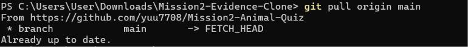

# 🐾 귀여운 동물 상식 퀴즈

## 1. 프로젝트 소개

강아지, 고양이, 토끼 등 귀여운 동물에 관한 상식을 재미있게 배울 수 있는 Python 콘솔 퀴즈 게임입니다.

사용자는 퀴즈를 풀거나 직접 문제를 추가하고 삭제할 수 있으며, 최고 점수와 퀴즈 데이터를 저장하여 다음 실행에도 이용할 수 있습니다.

## 2. 주제 및 선택 이유

평소 관심이 있는 동물을 주제로 선정했습니다. 퀴즈를 통해 동물에 관한 지식을 쉽고 재미있게 익힐 수 있도록 만들었습니다.

## 3. 실행 방법

Python 3.10 이상이 필요합니다.

터미널에서 프로젝트 폴더로 이동한 후 다음 명령어를 실행합니다.

```bash
python main.py
```

## 4. 주요 기능

- 동물 상식 퀴즈 풀기
- 새로운 퀴즈 추가하기
- 등록된 퀴즈 목록 확인하기
- 최고 점수 확인하기
- 퀴즈 데이터 자동 저장 및 불러오기
- 사용자 입력값 검증
- 등록된 퀴즈 삭제하기
- 퀴즈 결과 정답률 표시
- 점수에 따른 격려 메시지 출력
- 정답 및 오답 결과 안내
- Ctrl+C 또는 입력 종료 상황에서 안전 종료 및 저장 시도

기본 동물 퀴즈는 강아지, 고양이, 토끼, 햄스터, 펭귄에 관한 5개 문제로 구성됩니다.

## 5. 파일 구조

```text
Mission2-Animal-Quiz/
├── main.py
├── state.json
├── .gitignore
└── README.md
```

- `main.py`: 퀴즈 클래스, 게임 진행, 입력 검증, 데이터 입출력 기능
- `state.json`: 퀴즈와 최고 점수 데이터 저장
- `.gitignore`: Git에 포함하지 않을 파일 지정
- `README.md`: 프로젝트 설명 및 사용 방법

## 6. 객체지향 설계 및 클래스 역할

이 프로젝트는 `Quiz`와 `QuizGame` 두 클래스를 사용합니다.

### Quiz 클래스

하나의 퀴즈 데이터를 관리합니다.

- 문제 내용
- 선택지 목록
- 정답
- 퀴즈 데이터를 딕셔너리 형태로 변환하는 기능

### QuizGame 클래스

퀴즈 게임 전체의 진행과 관리를 담당합니다.

- 게임 초기화
- 퀴즈 실행
- 퀴즈 추가 및 삭제
- 퀴즈 목록 출력
- 최고 점수 관리
- JSON 데이터 불러오기 및 저장하기
- 메뉴 출력 및 사용자 입력 처리

### 클래스를 사용한 이유

클래스를 사용하면 관련 데이터와 기능을 하나의 구조로 관리할 수 있습니다.

`Quiz`는 개별 문제의 정보를 관리하고, `QuizGame`은 게임 전체를 관리하도록 역할을 분리했습니다.

함수만 사용하는 방식보다 데이터와 기능의 관계를 명확하게 표현할 수 있으며, 새로운 기능을 추가하거나 수정할 때 관리하기 쉽다는 장점이 있습니다.

## 7. 입력 검증과 데이터 입출력 분리

사용자가 입력한 값은 각 기능에서 필요한 형식과 범위를 확인한 후 사용합니다.

입력 검증의 예시는 다음과 같습니다.

- 메뉴에서 허용되지 않은 번호를 입력한 경우
- 숫자가 필요한 곳에 숫자가 아닌 값을 입력한 경우
- 선택지 번호가 허용 범위를 벗어난 경우
- 이미 등록된 문제나 선택지를 다시 입력한 경우
- 필수 입력값을 비워 둔 경우

데이터 입출력은 `load_data()`와 `save_data()`에서 담당합니다.

- 입력 검증: 사용자 입력이 올바른지 확인
- 데이터 입출력: JSON 파일을 읽고 쓰는 작업
- 게임 기능: 검증된 입력을 이용해 퀴즈 진행 및 관리

이렇게 역할을 구분하여 코드의 유지보수와 기능 확장이 쉽도록 구성했습니다.

## 8. 데이터 저장 방식

`state.json` 파일에 퀴즈와 최고 점수를 JSON 형식으로 저장합니다.

### 데이터 구조 예시

```json
{
    "high_score": 2,
    "quizzes": [
        {
            "question": "강아지가 꼬리를 흔드는 행동은 무엇을 표현할까요?",
            "choices": ["기쁨이나 흥분", "배고픔", "졸음", "추위"],
            "answer": "1"
        }
    ]
}
```

### 각 필드의 역할

- `high_score`: 지금까지 기록한 최고 점수
- `quizzes`: 여러 퀴즈 데이터를 저장하는 목록
- `question`: 퀴즈 문제 내용
- `choices`: 문제에 해당하는 선택지 목록
- `answer`: 정답 선택지 번호

퀴즈가 여러 개이므로 `quizzes`를 목록으로 구성하고, 각 문제의 내용을 하나의 객체로 묶어 관리합니다.

이러한 중첩 구조를 사용하면 문제별 데이터의 관계를 명확하게 유지할 수 있습니다.

### JSON을 선택한 이유

장점:
- 사람이 읽고 수정하기 쉽습니다.
- Python에서 기본 라이브러리로 처리할 수 있습니다.
- 별도의 데이터베이스 설치가 필요하지 않습니다.
- 데이터 구조가 단순하여 작은 프로젝트에 적합합니다.

단점:
- 데이터가 매우 많아지면 파일 전체를 읽고 쓰는 과정에서 성능이 떨어질 수 있습니다.
- 파일을 메모리에 불러와 처리하므로 데이터 규모가 커지면 메모리 사용량이 증가할 수 있습니다.
- 여러 사용자가 동시에 데이터를 수정하는 상황에는 적합하지 않습니다.

현재 프로젝트처럼 데이터 규모가 작은 콘솔 프로그램에는 JSON이 적합하다고 판단했습니다.

## 9. JSON 데이터 읽기 및 저장 흐름

### 데이터 읽기

프로그램이 시작될 때 `load_data()`를 실행합니다.

1. `state.json` 파일이 존재하는지 확인합니다.
2. 파일을 UTF-8 형식으로 읽습니다.
3. JSON 데이터를 Python 자료형으로 변환합니다.
4. 데이터의 자료형과 필수 필드가 올바른지 검사합니다.
5. 유효한 퀴즈와 최고 점수를 게임에 반영합니다.
6. 파일이 없거나 손상된 경우 기본 퀴즈를 불러오는 예외 처리를 수행합니다.

### 데이터 저장

퀴즈 추가, 삭제, 최고 점수 갱신 등 데이터가 변경되는 경우 `save_data()`를 호출하여 `state.json`에 저장합니다.

프로그램을 다시 실행하면 저장된 퀴즈와 최고 점수를 불러올 수 있습니다.

## 10. 예외 처리 및 데이터 보호

JSON 파일을 읽고 저장하는 과정에서 발생할 수 있는 오류를 처리합니다.

**데이터 읽기**
- JSON 형식이 잘못된 경우
- 파일을 읽을 수 없는 경우
- 데이터 구조가 예상과 다른 경우
- 필수 데이터의 값이 올바르지 않은 경우

**데이터 저장 및 백업**
- 기존 `state.json` 파일을 `state.json.bak`으로 백업합니다.
- 새 데이터는 `state.json.tmp` 임시 파일에 먼저 기록한 뒤 원본 파일과 교체합니다.
- 파일 접근이나 데이터 기록에 실패하면 안내 메시지를 출력합니다.
- 저장 실패 시 임시 파일 정리를 시도합니다.

**데이터 복구**
- 원본 `state.json` 파일을 읽을 수 없으면 백업 파일에서 데이터 읽기를 시도합니다.
- 백업 파일을 정상적으로 읽으면 원본 파일로 복구합니다.
- 원본과 백업 파일 모두 사용할 수 없으면 기본 퀴즈 데이터를 불러옵니다.

또한 `KeyboardInterrupt`와 `EOFError`를 처리하여 사용자가 Ctrl+C를 누르거나 입력이 종료되는 상황에서도 저장을 시도하도록 구성했습니다.

백업 파일과 임시 파일은 `.gitignore`에 등록하여 Git 추적 대상에서 제외합니다.


## 11. Git 및 GitHub 관리

Git을 이용해 프로젝트의 변경 이력을 관리하고 GitHub 원격 저장소에 백업했습니다.

GitHub 저장소:

https://github.com/yuu7708/Mission2-Animal-Quiz

### 주요 커밋 이력

| 커밋 | 변경 내용 |
|---|---|
| `f35dd44` | 동물 퀴즈 프로그램 기본 기능 추가 |
| `8b922aa` | README와 gitignore 파일 추가 |
| `6ab4379` | 퀴즈 삭제 기능 추가 |
| `4b01eb6` | README에 퀴즈 삭제 기능 설명 추가 |
| `4f7ea81` | 중복 문제 등록 방지 기능 추가 |
| `4d25bd6` | 퀴즈 선택지 중복 입력 방지 기능 추가 |
| `e8f2e5c` | 선택지 중복 입력 시 재입력 처리 수정 |
| `5cc0e94` | 오답일 때 정답 안내 기능 추가 |
| `c20edc1` | 퀴즈 결과 정답률 표시 |
| `24a2460` | 점수별 격려 메시지 추가 |
| `aa808ea` | README 내용 업데이트 |
| `a35c07f` | JSON 저장 데이터 검증 기능 강화 |
| `0740d5f` | 데이터 백업 및 복구 기능 추가 |
| `8f456b7` | 저장 실패 처리와 README 평가 증거 보완 |
| `85ca3c7` | 최고 점수 및 퀴즈 목록 JSON 데이터 검증 강화 |

총 15개의 커밋을 통해 기본 기능 구현부터 입력 검증, 사용자 편의 기능, 데이터 보호 및 저장 실패 처리까지 단계적으로 개선하였다.

### 커밋 작성 기준

기능 하나 또는 의미 있는 수정 단위로 커밋합니다.

커밋 메시지는 변경한 내용을 간결하고 명확하게 작성합니다.

예시:

```bash
git add .
git commit -m "퀴즈 삭제 기능 추가"
git push origin main
```

작업 내용을 작은 단위로 나누어 저장하면 오류가 발생했을 때 변경 원인을 확인하거나 이전 상태로 돌아가기 쉽습니다.

## 12. 브랜치 생성 및 병합 전략

기능을 추가하거나 수정할 때 기존 프로그램에 영향을 줄 가능성이 있으면 별도 브랜치에서 작업할 수 있습니다.

이 프로젝트에서는 `feature/quiz-improvement` 브랜치를 사용하여 기능 개선 작업을 진행하고, 작업 결과를 `main` 브랜치에 병합했습니다.

- `main`: 안정적으로 관리하는 기본 브랜치
- `feature/quiz-improvement`: 기능 개선 작업을 진행하는 브랜치

브랜치를 분리하면 새로운 기능을 기존 코드와 독립적으로 수정하고 확인할 수 있습니다.

병합(Merge)은 별도 브랜치에서 완성한 변경 사항을 기본 브랜치에 합치는 과정입니다.

실습에 사용한 주요 명령어:

```bash
git branch feature/quiz-improvement
git checkout feature/quiz-improvement
git checkout main
git merge feature/quiz-improvement
```

### 실제 브랜치 작업 및 병합 확인 기록

다음은 실제 Git 저장소에서 확인한 브랜치 및 커밋 기록이다.

- 작업 브랜치: `feature/quiz-improvement`
- 작업 브랜치에서 생성한 커밋: `4b01eb6`
- 커밋 내용: README에 퀴즈 삭제 기능 설명 추가
- 해당 커밋은 이후 `main` 브랜치의 커밋 기록에도 포함되었다.
- 현재 원격 저장소에는 `origin/feature/quiz-improvement` 브랜치가 남아 있다.

실제 Git 기록 확인 명령어:

```bash
git log --graph --oneline --decorate --all
git branch -a
```

확인한 기록:

```text
* 0740d5f (HEAD -> main, origin/main, origin/HEAD) 데이터 백업 및 복구 기능 추가
...
* 4b01eb6 (origin/feature/quiz-improvement) README에 퀴즈 삭제 기능 설명 추가
...
```

이를 통해 기능 개선 커밋이 `main` 브랜치에도 반영된 것을 확인할 수 있다.

### 병합 방식 및 결과

이번 실습에서는 별도 기능 브랜치에서 작업한 후 `main` 브랜치로 변경 사항을 병합하는 과정을 진행했습니다.

병합 과정은 다음과 같습니다.

1. `feature/quiz-improvement` 브랜치를 생성했습니다.
2. 해당 브랜치에서 README의 퀴즈 삭제 기능 설명을 수정했습니다.
3. 수정 내용을 `4b01eb6` 커밋으로 저장했습니다.
4. `main` 브랜치로 이동한 후 병합을 진행했습니다.
5. 병합 결과 해당 커밋이 `main` 브랜치의 기록에도 포함되었습니다.

이번 실습에서는 Fast-forward 병합 방식으로 변경 사항을 반영했습니다. Fast-forward 병합은 별도의 병합 커밋을 만들지 않고 기존 커밋 이력을 그대로 이어 붙이는 방식입니다.

이를 통해 기능별 브랜치 작업과 기본 브랜치로의 통합 과정을 학습했습니다.

## 13. Git clone 및 pull 실습

원격 저장소의 프로젝트를 다른 폴더에 복제하는 `clone`과, 원격 저장소의 최신 변경 사항을 가져오는 `pull`을 실습했습니다.

사용한 명령어:

```bash
git clone https://github.com/yuu7708/Mission2-Animal-Quiz.git
```

복제한 프로젝트 폴더에서 다음 명령어를 실행합니다.

```bash
git pull origin main
```

실습 과정에서 `Already up to date.` 메시지를 확인하여 원격 저장소와 로컬 저장소가 동기화되어 있음을 확인했습니다.

### 실습 결과

GitHub 저장소를 별도 폴더에 복제하고 원격 저장소의 변경 사항을 가져오는 실습을 진행했습니다.

```text
git clone https://github.com/yuu7708/Mission2-Animal-Quiz.git ..\Mission2-Animal-Quiz-clone

Receiving objects: 100% (44/44), done.
Resolving deltas: 100% (21/21), done.

git -C ..\Mission2-Animal-Quiz-clone pull origin main

Already up to date.

git -C ..\Mission2-Animal-Quiz-clone status

On branch main
Your branch is up to date with 'origin/main'.

nothing to commit, working tree clean

git -C ..\Mission2-Animal-Quiz-clone log -1 --oneline

0740d5f 데이터 백업 및 복구 기능 추가
```

## 14. 요구사항 변경 시 영향도

기능을 변경할 때 관련 파일과 메서드를 확인하여 수정 범위를 파악합니다.

| 변경 요구사항 | 주요 수정 대상 |
|---|---|
| 퀴즈 문제 구조 변경 | `Quiz` 클래스, `to_dict()`, `load_data()` |
| 퀴즈 출제 방식 변경 | `QuizGame.play_quiz()` |
| 퀴즈 추가 방식 변경 | `QuizGame.add_quiz()` |
| 퀴즈 목록 표시 변경 | `QuizGame.show_quizzes()` |
| 퀴즈 삭제 방식 변경 | `QuizGame.delete_quiz()` |
| 최고 점수 처리 변경 | `QuizGame.show_high_score()`, `play_quiz()` |
| JSON 저장 구조 변경 | `load_data()`, `save_data()`, `state.json` |
| 메뉴 변경 | `QuizGame.show_menu()` 및 메뉴 실행 부분 |
| 실행 방법이나 기능 설명 변경 | `README.md` |

이처럼 기능별 담당 위치를 정리하면 변경 시 영향을 받는 부분을 빠르게 확인할 수 있습니다.

## 15. 향후 개선 사항

### 현재 구현된 데이터 보호 기능

- JSON 파일 저장 실패 시 예외 처리
- 기존 데이터를 `state.json.bak` 파일로 자동 백업
- 원본 파일을 읽을 수 없을 때 백업 파일에서 복구
- `state.json.tmp` 임시 파일에 먼저 기록한 뒤 원본 파일과 교체하여 데이터 손상 위험 감소

### 향후 개선할 사항

- 데이터가 많아지면 SQLite 등 데이터베이스 사용 검토
- 자동 테스트 코드 추가
- 다양한 예외 상황에 대한 테스트 확대
- 실행 및 테스트 결과를 README에 기록하여 검증 과정 보강

## Git clone 및 pull 실행 증빙


